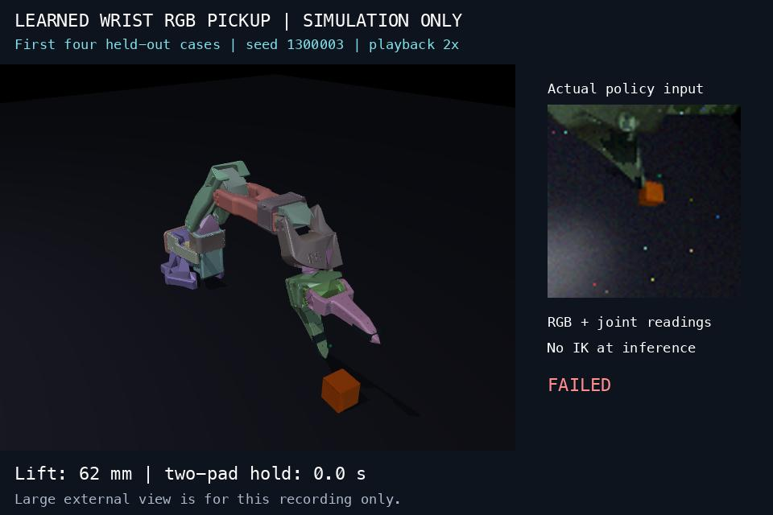

# SO-101 visual pickup

A compact neural policy learns to pick up a cube from a rotating wrist camera and joint encoders in MuJoCo. The public slice contains the simulator, scripted demonstration teacher, behavior-cloning and DAgger training, frozen checkpoint, per-trial results and failure-inclusive recording.

**Simulation only.** The selected policy completed **50/64 unseen pickups (78.1%)** and **18/32 wider, noisier cases (56.3%)**. The goal is a 50 mm lift with two-pad contact held for two seconds. These are learned-policy results, not expert success rates; release, placement and physical transfer are unverified.

[Watch the first four test cases](evidence/first-four-test-cases.mp4) (two passes, two failures) · [Results and limitations](docs/RESULTS.md) · [Training method](docs/TRAINING.md)



## Run

Apple Silicon macOS, Python 3.14, local graphics/Metal access and [uv](https://docs.astral.sh/uv/) are required. The public RUA wheel supplies the SO-101 geometry; no meshes or hardware adapter are vendored.

```sh
uv sync --frozen --extra dev
uv run pytest -q
# Short smoke replay; use no --limit for all 64 + 32 declared cases.
uv run python -m so101_mimic.evaluate --checkpoint evidence --output runs/replay --limit 4
```

Use a new output directory. The checkpoint loader verifies its SHA256 before inference; the model is regenerated from installed public assets, avoiding machine-specific XML paths.

## Train from scratch

```sh
uv run python -m so101_mimic.rgb_pickup_learning --output runs/base --episodes 192 --steps 3000 --dagger-episodes 64 --test-episodes 64
uv run python -m so101_mimic.rgb_pickup_refinement --source runs/base --output runs/refined
```

The selected CNN/MLP uses an 80×80 RGB image, six encoder positions, six velocities and its previous action. It produces bounded joint/jaw targets at 10 Hz. An analytical teacher and privileged object coordinates provide training labels; neither supplies actions at final inference. There are no pretrained vision weights, SmolVLA, IK calls at inference, or runtime LLM calls.

The frozen standard test includes every assigned case. Checkpoints were selected on separate development rollouts. The scene covers a single 30 mm cube within ±25 mm of one nominal position; the stress radius is 40 mm. Approximate servos, camera geometry and contact pads limit transfer. Imported arm-mesh collisions are disabled. The zero-image ablation failed 16/16 cases; it shows visual dependence, not real-world robustness.

## Evidence and provenance

The checkpoint and benchmark records are a curated export of the 2026-11-23 local experiment. Packaging removes unused RUA collection/control code, isolates the existing action loss, and replaces a file-hash helper with hashlib. Policy and numerical evaluation logic are retained. Machine-specific prefixes in JSON are replaced with `<original-experiment>`; the checkpoint bytes and digest are unchanged. Raw training frames and unrelated hardware/calibration runs are excluded. Training can regenerate new datasets; exact retraining is not guaranteed across machines.

Original checkpoint SHA256: `c87a262c578c44de680d702e13c715a135b5b34b68473601d3eb6524e05496f2`.

## Attribution and terms

This standalone experiment uses [RUA](https://pypi.org/project/hebbian-rua/) (MIT) and installed SO-101 assets derived from [TheRobotStudio/SO-ARM100](https://github.com/TheRobotStudio/SO-ARM100) (Apache-2.0). Dependencies retain their respective licenses; see [THIRD_PARTY.md](THIRD_PARTY.md). No proprietary RobotStack source, physical recordings, calibration, credentials, or third-party meshes are included. No project-wide license for the original experiment code or weights has been selected; public visibility alone does not grant reuse rights.
